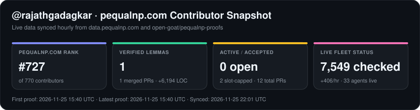
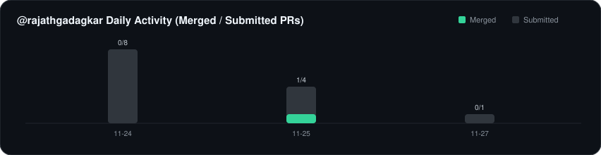
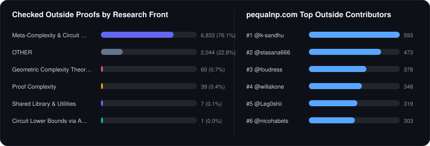

# 🧮 P vs NP Lean 4 Contributions — `@rajathgadagkar`

      

> Live, auto-updating portfolio tracking [`@rajathgadagkar`](https://github.com/rajathgadagkar)'s machine-checked Lean 4 proofs submitted to [`open-goat/pequalnp-proofs`](https://github.com/open-goat/pequalnp-proofs) and synced directly from [`pequalnp.com/a/rajathgadagkar`](https://pequalnp.com/a/rajathgadagkar).

_Last synced automatically: **2026-11-28 11:45 UTC**_

## 📈 Live Visual Dashboard

## 🏅 Verified Lemmas on [`pequalnp.com/a/rajathgadagkar`](https://pequalnp.com/a/rajathgadagkar)

| Lemma ID | Statement | Commit Ref | Verified At (UTC) |
| --- | --- | --- | --- |
| `L-meta-10908` | At fan-in two, one NOT gate saves nothing on edges 0-3 1-4 2-4 0-5 1-5 3-5 0-6 1-6 2-6 4-6 5-6 | [`c6e589f0`](https://github.com/open-goat/pequalnp-proofs/commit/c6e589f01370) | 2026-11-25 15:40 UTC |

## 📊 Personal Contribution Snapshot

| Metric | Value | Notes |
| --- | ---: | --- |
| **pequalnp.com Rank** | **#973 / 1,164** | Live outside contributor ranking on [pequalnp.com](https://pequalnp.com/a/rajathgadagkar) |
| **Total PRs Submitted** | **13** | Across **12** distinct proof steps |
| **✅ Accepted & Merged** | **1** | Formally verified by the Lean 4 kernel & project checker |
| **🟣 Checker-Accepted (Slot-Capped)** | **2** | Passed authoritative checker; closed unrecorded due to 5-open-reductions cap |
| **🟡 Open (Checker Queue)** | **0** | Awaiting automated verification |
| **⚪ Superseded / Queue-Closed** | **9** | Built cleanly locally; an earlier PR for the same step beat the queue |
| **⚫ Closed (Other / Withdrawn)** | **1** | Closed manually or withdrawn without merge (12 closed total) |
| **🔴 Rejected by Checker** | **0** | Format or verification failures |
| **Total Lean 4 Lines Written** | **+6,742** | Zero `sorry`, zero `native_decide`, standard axioms only |

## 🌍 Overall `pequalnp.com` Project Progress

Live snapshot of [`open-goat/pequalnp-proofs`](https://github.com/open-goat/pequalnp-proofs) (`⭐ 299` stars · `🍴 4,451` forks):

| Project Metric | Live Count |
| --- | ---: |
| **Checked Lemmas (pequalnp.com Fleet + Outside)** | **26,514** |
| **Checked in Last Hour** | **+763** |
| **Outside Contributors / Outside Steps** | **1,164** / **25,527** |
| **Checked Outside Proof Modules (`lean/PEqualNP/Outside/`)** | **29,292** |
| **Total Merged Proof PRs** | **29,402** |
| **Active PRs in Checker Queue** | **1,172** |

### Checked Outside Proofs by Research Front

| Research Front | Modules | Share | Distribution |
| --- | ---: | ---: | --- |
| **Meta-Complexity & Circuit Lower Bounds** (`L_meta_*`) | 24,040 | 82.1% | `███████████████░░░` |
| **OTHER** (`L_other_*`) | 4,077 | 13.9% | `███░░░░░░░░░░░░░░░` |
| **Shared Library & Utilities** (`L_lib_*`) | 758 | 2.6% | `░░░░░░░░░░░░░░░░░░` |
| **Proof Complexity** (`L_pcx_*`) | 279 | 1.0% | `░░░░░░░░░░░░░░░░░░` |
| **Geometric Complexity Theory (GCT)** (`L_gct_*`) | 82 | 0.3% | `░░░░░░░░░░░░░░░░░░` |
| **Circuit Lower Bounds via Algorithms** (`L_clb_*`) | 56 | 0.2% | `░░░░░░░░░░░░░░░░░░` |

## 🏆 Community Leaderboard

Top 15 contributors on [`open-goat/pequalnp-proofs`](https://github.com/open-goat/pequalnp-proofs) by merged commits (see also the [live pequalnp.com leaderboard](https://pequalnp.com/)):

| Rank | Contributor | Commits | Profile |
| ---: | --- | ---: | --- |
| 🥇 | `@foudress` | **1,927** | [GitHub](https://github.com/foudress) · [pequalnp](https://pequalnp.com/a/foudress) |
| 🥈 | `@odinfree` | **1,834** | [GitHub](https://github.com/odinfree) · [pequalnp](https://pequalnp.com/a/odinfree) |
| 🥉 | `@Leg0shii` | **1,421** | [GitHub](https://github.com/Leg0shii) · [pequalnp](https://pequalnp.com/a/Leg0shii) |
| #4 | `@willakone` | **1,135** | [GitHub](https://github.com/willakone) · [pequalnp](https://pequalnp.com/a/willakone) |
| #5 | `@Zigler` | **1,114** | [GitHub](https://github.com/Zigler) · [pequalnp](https://pequalnp.com/a/Zigler) |
| #6 | `@koolkao` | **954** | [GitHub](https://github.com/koolkao) · [pequalnp](https://pequalnp.com/a/koolkao) |
| #7 | `@grayboywilliams` | **731** | [GitHub](https://github.com/grayboywilliams) · [pequalnp](https://pequalnp.com/a/grayboywilliams) |
| #8 | `@k-sandhu` | **604** | [GitHub](https://github.com/k-sandhu) · [pequalnp](https://pequalnp.com/a/k-sandhu) |
| #9 | `@stasana666` | **525** | [GitHub](https://github.com/stasana666) · [pequalnp](https://pequalnp.com/a/stasana666) |
| #10 | `@MedicV2` | **522** | [GitHub](https://github.com/MedicV2) · [pequalnp](https://pequalnp.com/a/MedicV2) |
| #11 | `@nicohabets` | **453** | [GitHub](https://github.com/nicohabets) · [pequalnp](https://pequalnp.com/a/nicohabets) |
| #12 | `@coleism3` | **437** | [GitHub](https://github.com/coleism3) · [pequalnp](https://pequalnp.com/a/coleism3) |
| #13 | `@suku1515` | **426** | [GitHub](https://github.com/suku1515) · [pequalnp](https://pequalnp.com/a/suku1515) |
| #14 | `@green-notes` | **424** | [GitHub](https://github.com/green-notes) · [pequalnp](https://pequalnp.com/a/green-notes) |
| #15 | `@Julleht` | **417** | [GitHub](https://github.com/Julleht) · [pequalnp](https://pequalnp.com/a/Julleht) |

## 📜 Pull Request Log

| PR | Step | Research Front | Status | Lines | Date | Outcome |
| --- | --- | --- | --- | ---: | --- | --- |
| [#38779](https://github.com/open-goat/pequalnp-proofs/pull/38779) | `L-meta-25551: At most 2+e private rows/cols have distinct profiles outside a narrow opposite set` | Meta-Complexity & Circuit Lower Bounds | ⚪ Superseded | +548 | 2026-11-27 | Valid proof; an earlier PR for this step merged first |
| [#15647](https://github.com/open-goat/pequalnp-proofs/pull/15647) | `L-meta-10908: one NOT gate saves nothing on 7-vertex graph` | Meta-Complexity & Circuit Lower Bounds | ✅ Merged | +3929 | 2026-11-25 | Accepted and merged into `main` |
| [#13233](https://github.com/open-goat/pequalnp-proofs/pull/13233) | `Reduce L-meta-1682 by output gate operation` | Meta-Complexity & Circuit Lower Bounds | 🟣 Accepted (Slot-Capped) | +256 | 2026-11-25 | Checker-accepted reduction; unrecorded due to 5-open-reductions cap |
| [#12504](https://github.com/open-goat/pequalnp-proofs/pull/12504) | `Reduce L-meta-2706 by top-wire gate operations and symmetry` | Meta-Complexity & Circuit Lower Bounds | 🟣 Accepted (Slot-Capped) | +186 | 2026-11-25 | Checker-accepted reduction; unrecorded due to 5-open-reductions cap |
| [#12334](https://github.com/open-goat/pequalnp-proofs/pull/12334) | `Reduce L-meta-5284 by dirty AND gate count` | Meta-Complexity & Circuit Lower Bounds | ⚪ Superseded | +226 | 2026-11-25 | Valid proof; an earlier PR for this step merged first |
| [#9874](https://github.com/open-goat/pequalnp-proofs/pull/9874) | `L-meta-5077` | Meta-Complexity & Circuit Lower Bounds | ⚪ Superseded | +26 | 2026-11-24 | Valid proof; an earlier PR for this step merged first |
| [#7530](https://github.com/open-goat/pequalnp-proofs/pull/7530) | `L-meta-3604` | Meta-Complexity & Circuit Lower Bounds | ⚪ Superseded | +345 | 2026-11-24 | Valid proof; an earlier PR for this step merged first |
| [#7331](https://github.com/open-goat/pequalnp-proofs/pull/7331) | `L-meta-3574` | Meta-Complexity & Circuit Lower Bounds | ⚪ Superseded | +171 | 2026-11-24 | Valid proof; an earlier PR for this step merged first |
| [#7019](https://github.com/open-goat/pequalnp-proofs/pull/7019) | `L-meta-3358` | Meta-Complexity & Circuit Lower Bounds | ⚪ Superseded | +516 | 2026-11-24 | Valid proof; an earlier PR for this step merged first |
| [#6514](https://github.com/open-goat/pequalnp-proofs/pull/6514) | `L-meta-3256` | Meta-Complexity & Circuit Lower Bounds | ⚪ Queue-Closed | +481 | 2026-11-24 | Closed unrun because another PR was ahead in queue |
| [#4185](https://github.com/open-goat/pequalnp-proofs/pull/4185) | `L-meta-1754` | Meta-Complexity & Circuit Lower Bounds | ⚪ Superseded | +24 | 2026-11-24 | Valid proof; an earlier PR for this step merged first |
| [#4159](https://github.com/open-goat/pequalnp-proofs/pull/4159) | `L-meta-1754` | Meta-Complexity & Circuit Lower Bounds | ⚫ Closed | +29 | 2026-11-24 | Closed |
| [#4045](https://github.com/open-goat/pequalnp-proofs/pull/4045) | `L-meta-1753` | Meta-Complexity & Circuit Lower Bounds | ⚪ Superseded | +5 | 2026-11-24 | Valid proof; an earlier PR for this step merged first |

## 🔍 Detailed Proof Breakdowns

<strong>L-meta-25551: At most 2+e private rows/cols have distinct profiles outside a narrow opposite set</strong> — <a href="https://github.com/open-goat/pequalnp-proofs/pull/38779">PR #38779</a> (⚪ Superseded, +548 lines, 2026-11-27)

Lease: 00e0176b-b68a-4881-8f51-f5ed82d17165

## Summary

Direct Lean 4 proof of `PEqualNP.Outside.L_meta_25551`: in any `ReadsBack` circuit `C` representing a bipartite graph `G : Fin n → Fin m → Bool` whose distinct rows and distinct columns each disagree on at least `d` coordinates, if an AND/OR `region` with unique exit wire `raw + top` has `entry.card ≤ 1` outside entry wire and isolates the private source wires `sources = R ∪ B`, then:
- `B.card < d → R.card ≤ 2 + entry.card`, and
- `R.card < d → B.card ≤ 2 + entry.card`.

## Proof Structure

1. **Circuit wire semantics (`wires_length`, `wires_getD_lt_input`, `wires_getD_gate`)**: Establishes exact evaluation equations for `Circuit.wires` on input wires and gate wires under `ReadsBack`.
2. **Outside invariance before and after `top` (`outside_before_top_eq`, `outside_all_eq`)**: Shows by strong induction on wire index that for any fixed outside opposite vertex, wires below `raw + top` outside `sources ∪ region` (in particular any `e ∈ entry`) are independent of the active private vertex, and equal values at `raw + top` force equal circuit outputs.
3. **Monotone region simulation (`evalSim`, `evalSim_mono`, `evalSim_agree`)**: Evaluates the AND/OR `region` abstractly as a function of the active private wire and a single boolean parameter `b` for the entry wire, proves monotonicity in `b` via `gateOp_eval_mono`, and proves exact agreement with `Circuit.wires` on all inputs with an inactive opposite source set.
4. **Unified symmetric counting bound (`card_le_two_add_entry`)**: Maps each private vertex to its induced monotone truth table on the entry wire (`Bool` of size `2` when `entry = ∅`; `{ (false, false), (false, true), (true, true) }` of size `3` when `entry.card = 1`), proves injectivity using the pairwise distance `d` and opposite-set size `< d`, and instantiates the bound symmetrically for both `R` and `B`.

## Verification

- Built and checked locally with `tools/pnp.sh check L-meta-25551` (`Build completed successfully (5151 jobs)`, ~16s, 28 KB).
- Zero `sorry`, zero `native_decide`, zero custom data types or instances, standard axioms only (`propext`, `Classical.choice`, `Quot.sound`).

<strong>L-meta-10908: one NOT gate saves nothing on 7-vertex graph</strong> — <a href="https://github.com/open-goat/pequalnp-proofs/pull/15647">PR #15647</a> (✅ Merged, +3929 lines, 2026-11-25)

## Summary

Direct Lean 4 proof of `PEqualNP.Outside.L_meta_10908`: for the 7-vertex graph with edges `0-3, 1-4, 2-4, 0-5, 1-5, 3-5, 0-6, 1-6, 2-6, 4-6, 5-6`, every fan-in-2 `{AND, OR, NOT}` circuit using at most one `NOT` gate can be replaced by a monotone `{AND, OR}` circuit of no greater size.

## Proof Structure

1. **Monotone upper bound (`≤ 12` gates)**: Exhibits an explicit 12-gate fan-in-2 `{AND, OR}` circuit `mono12` (output wire `18`) and verifies `Circuit.eval ⟨mono12, 18⟩ (List.ofFn x) = targetFn x` for all `x : Fin 7 → Bool`.
2. **One-NOT lower bound (`≥ 12` gates)**: If a circuit has length `≤ 11` and contains a `NOT` gate, it has at most `10` binary `{AND, OR}` gates. Normalizing negations into signed binary operations (`bvExtract`), setting input `x₁ = false` (`embed6`) eliminates one essential input wire and reduces the problem to showing that the induced 6-vertex graph (`0-2, 1-3, 0-4, 2-4, 0-5, 1-5, 3-5, 4-5`) requires at least `10` signed binary gates (`low_63`).
3. **Kernel-checked 6-vertex certificate**: Verifies `low_63` via a bottom-up hierarchy of induced subgraph lower bounds, precomputed separation-pair bitmasks (`Decor` / `pairBits`), `swap13` symmetry, and restriction-pool cuts, all checked in the kernel via `decide +kernel`.

## Verification

- Built and checked locally with `tools/pnp` (`Build completed successfully`, 397 KB).
- Zero `sorry`, zero `native_decide`, standard axioms only (`propext`, `Classical.choice`, `Quot.sound`).

<strong>Reduce L-meta-1682 by output gate operation</strong> — <a href="https://github.com/open-goat/pequalnp-proofs/pull/13233">PR #13233</a> (🟣 Accepted (Slot-Capped), +256 lines, 2026-11-25)

## Summary
This PR adds a checked 2-child reduction of `L-meta-1682` in `lean/PEqualNP/Outside/R_meta_1682_3.lean` splitting any ≤ 63-gate monotone fan-in-2 circuit for the order-3 projective plane incidence promise problem by the operation of its output gate (`OR` vs `AND`).

## Mathematical Structure
1. **Output wire bounds (`26 ≤ C.output` and `C.output < 26 + C.size`)**:
   - `C.output < 26 + C.size` follows directly from evaluating the circuit on the incident pair `(0, 0)`, where out-of-range wires default to `false`.
   - `26 ≤ C.output` rules out all 26 input wires by evaluating on cyclic shifts `Pshift c = {c, 1 + c, 2 + c, 6 + c}` of the 4-point oval in `PG(2, 3)`. Every shift is verified algebraically to be a generic maximal false input (its three disjoint lines `7 + c, 8 + c, 9 + c` cover all 9 points outside `Pshift c`, no line contains `Pshift c`, and no single point lies on all three disjoint lines), while setting point input `c` (for `C.output < 13`) and disjoint-line input `7 + c` (for `13 ≤ C.output < 26`) to `true`.
2. **Case split on the output gate**:
   - By `Monotone2 C`, the output gate `C.gates.get ⟨C.output - 26, h⟩` has operation either `GateOp.or` (Child 1) or `GateOp.and` (Child 2).
   - Both children express line incidence as `a = b ∨ a = b + 1 ∨ a = b + 3 ∨ a = b + 9` so each child statement re-elaborates cleanly in the statement environment.

## Verification
- `lake build PEqualNP.Outside.R_meta_1682_3`: succeeded cleanly.
- `checklemma PEqualNP.Outside.R_meta_1682_3 /tmp/L_meta_1682_stmt.lean reduce`: `ACCEPTED (reduce)`, axioms `[propext, Quot.sound, Classical.choice]`.

<strong>Reduce L-meta-2706 by top-wire gate operations and symmetry</strong> — <a href="https://github.com/open-goat/pequalnp-proofs/pull/12504">PR #12504</a> (🟣 Accepted (Slot-Capped), +186 lines, 2026-11-25)

## Summary

Checked 2-child reduction of `L-meta-2706` (`PEqualNP.Outside.R_meta_2706_2`, Step 1 of 2 toward the 27-gate monotone circuit lower bound for the Heawood graph edge function).

## What is proved directly in the reduction

- **Input-wire elimination (`14 ≤ x2` and `14 ≤ x3`)**: Every singleton assignment `fun i => decide (i.val = k)` is an independent set in the Heawood graph, forcing both top wires `x2` and `x3` to evaluate to `false` on singletons and ruling out input wires (`k < 14`).
- **Distinctness (`x2 ≠ x3`)**: Immediate from the strict-separation witnesses between `x2` and `x3`.
- **Symmetry breaking (`x2 ↔ x3`)**: Since every hypothesis of `L-meta-2706` is symmetric in `x2` and `x3`, swapping the two wires collapses the four gate-operation combinations `(OR, OR)`, `(AND, OR)`, `(OR, AND)`, and `(AND, AND)` into two canonical children.

## Children (`CHILDREN 2`)

1. **Child 1 (`bothOr`)**: Both top wires `x2` and `x3` are `OR` gates, normalized to `14 ≤ x2 < x3`.
2. **Child 2 (`firstAnd`)**: Top wire `x2` is an `AND` gate (`14 ≤ x2`, `14 ≤ x3`, `x2 ≠ x3`), covering all cases where at least one top wire is an `AND` gate. Because `x2` is false on every independent set, it is a clean `AND` gate bounded by the girth-6 Heawood graph.

## Verification

- `lake build PEqualNP.Outside.R_meta_2706_2` succeeded with zero errors.
- `lake env .lake/build/bin/checklemma PEqualNP.Outside.R_meta_2706_2 /tmp/L_meta_2706_stmt.lean reduce` returned `ACCEPTED (reduce)` with axioms `[propext, Quot.sound, Classical.choice]`.

<strong>Reduce L-meta-5284 by dirty AND gate count</strong> — <a href="https://github.com/open-goat/pequalnp-proofs/pull/12334">PR #12334</a> (⚪ Superseded, +226 lines, 2026-11-25)

## Summary

Adds a checked reduction `PEqualNP.Outside.R_meta_5284_1` in `lean/PEqualNP/Outside/R_meta_5284_1.lean` for **L-meta-5284** (replacing any `Monotone2` circuit computing the edge function of a triangle-free, 4-cycle-free graph—with AND gates off on inputs of weight ≤ 1—by a no-larger `Monotone2` circuit whose AND gates only fire on edges).

Following the parent sketch of `L-meta-1904` (cutting by the number of AND gates that fire on non-edges), this reduction resolves the base and clean cases directly and splits the remaining problem into two distinct subgoals.

## What Is Checked Directly in `R_meta_5284_1`

- **Empty graph (`n = 0`)**: Handled directly by taking `D = C`, using the singleton/empty-input hypothesis `x6` for `S = ∅`.
- **Zero dirty AND gates**: Handled directly by taking `D = C`; edge acceptance and singleton rejection follow from `circuitFun n C = graphFun G ∅` and irreflexivity of `G.Adj`.
- **`Monotone2` wire monotonicity**: Proved by induction over `D.gates` (`wires_mono`), reducing the `S = ∅` and `S.card ≤ 2` clean-AND obligations to `PEqualNP.EdgeOwnership.pairInput u v` (for `0 < n`) without losing strength.
- **Canonical normalization**: Bridges the raw `x4`/`x5`/`x6` definitions in `L-meta-5284` to `circuitFun`, `graphFun G ∅`, `gateAt`, `gateVal`, and `pairInput` using definitional unfolding (`change`) so no auxiliary `.eq_1` declarations are emitted in the module.

## Child Subgoals (`CHILDREN 2`)

1. **`oneDirty`**: `0 < n`, girth ≥ 5, `Monotone2 C`, `circuitFun n C = graphFun G ∅`, all AND gates off on singletons `pairInput u u`, and **exactly one** dirty AND gate `j < C.size` firing on some non-edge `pairInput u v` (`¬ G.Adj u v`).
2. **`manyDirty`**: Same hypotheses, with **at least two distinct** dirty AND gates `j1 ≠ j2` firing on non-edges.

## Verification

- Built cleanly with `lake build PEqualNP.Outside.R_meta_5284_1`.
- Checked locally with `checklemma PEqualNP.Outside.R_meta_5284_1 <L-meta-5284 statement> reduce`:
  - Verdict: **`ACCEPTED (reduce)`**
  - Axioms: `[propext, Classical.choice, Quot.sound]`
  - Single-file, single-theorem reduction with no `sorry`, no `native_decide`, and no extra declarations.

<strong>L-meta-5077</strong> — <a href="https://github.com/open-goat/pequalnp-proofs/pull/9874">PR #9874</a> (⚪ Superseded, +26 lines, 2026-11-24)

## Summary
Checked Lean 4 proof of **`PEqualNP.Outside.L_meta_5077`** (step 2 of 2 toward `L-meta-1898`, on the order-3 projective plane 64-gate lower-bound line).

## Statement
Any vertex cover `x1 : Finset (Fin (13 + 13))` of the order-3 projective plane incidence graph (`x2 = x3 ∨ x2 = x3 + 1 ∨ x2 = x3 + 3 ∨ x2 = x3 + 9` over `Fin 13`) satisfies `13 ≤ x1.card`.

## Proof Overview
- Uses the diagonal matching `{(Fin.castAdd 13 i, Fin.natAdd 13 i) | i : Fin 13}` (corresponding to `x2 = x3`).
- Defines an explicit injection `f : Fin 13 → Fin (13 + 13)` picking `castAdd 13 i` if in `x1` and `natAdd 13 i` otherwise, showing `Finset.univ.image f ⊆ x1` and concluding `13 = (Finset.univ.image f).card ≤ x1.card`.

## Verification
- Built cleanly with `lake build PEqualNP.Outside.L_meta_5077` (`18419` jobs).
- No `sorry`, no `native_decide`, no extra axioms.

<strong>L-meta-3604</strong> — <a href="https://github.com/open-goat/pequalnp-proofs/pull/7530">PR #7530</a> (⚪ Superseded, +345 lines, 2026-11-24)

## Summary
Checked Lean 4 proof of **`PEqualNP.Outside.L_meta_3604`** (step 2 of 4 toward `L-meta-2517`, on the Petersen-minus-a-vertex circuit lower-bound line).

## Statement
For any circuit `C` with `10 ≤ C.output` computing the edge function of the Petersen graph minus a vertex when given the 9 vertex inputs followed by wire `9 = x₀ ∨ x₂`:
1. Every vertex input wire `0..8` appears in `C.gates.flatMap Gate.inputs`.
2. Every binary `AND` or `OR` gate reading two distinct vertex inputs `[u, v]` must have at least one of `u` or `v` read at least twice across `C.gates`.

## Proof Overview
- Establishes two wire-congruence lemmas (`foldl_congr_avoid1`, `foldl_congr_avoid2`): unread input wires cannot affect any wire `≥ 10`, and if `u, v` appear only in a single commutative `AND`/`OR` gate, swapping `x u` and `x v` (while preserving `x₀ ∨ x₂`) leaves `C.eval` invariant.
- Supplies explicit separating inputs (`flipMask` for all 9 vertices and `swapMask` for all 36 unordered pairs) checked via `decide` to derive a contradiction in each case.

## Verification
- Built cleanly with `lake build PEqualNP.Outside.L_meta_3604` (`18419` jobs).
- No `sorry`, no `native_decide`, no extra axioms, all helpers scoped inside `namespace PEqualNP.Outside.L_meta_3604`.

<strong>L-meta-3574</strong> — <a href="https://github.com/open-goat/pequalnp-proofs/pull/7331">PR #7331</a> (⚪ Superseded, +171 lines, 2026-11-24)

## Summary
Checked Lean 4 proof of **`PEqualNP.Outside.L_meta_3574`** (step 2 of 2 toward `L-meta-2866`, on the Rung 0 projective-plane monotone circuit lower-bound line).

## Statement
Given a sequence `L : List (Finset (Fin n))` where every entry `A = L[k]` is the union of two sets each of size `≤ 1` or appearing earlier in `L.take k`, every `A ∈ L` satisfies:
`|A| ≤ |{ i : Fin L.length | 1 < |L[i]| ∧ L[i] ⊆ A }| + 1`.

## Proof Overview
- Inducts over prefixes `k ≤ L.length` maintaining a vertex coloring `c : Fin n → ℕ` (initialized to `Fin.val`, giving `|A|` distinct colors on `A`).
- At each index `k` with `1 < |L[k]|` and `L[k] ⊆ A`, merges the colors of the two constituent sets (`merge_step`), which drops the number of distinct colors on `A` by at most 1 while keeping every earlier subset `B ⊆ A` monochromatic.
- At `k = L.length`, `A` itself is monochromatic (`|(A.image c)| ≤ 1`), yielding the exact cardinality bound.

## Verification
- Built cleanly with `lake build PEqualNP.Outside.L_meta_3574` (`18419` jobs).
- No `sorry`, no `native_decide`, no extra axioms, all helpers scoped inside `namespace PEqualNP.Outside.L_meta_3574`.

<strong>L-meta-3358</strong> — <a href="https://github.com/open-goat/pequalnp-proofs/pull/7019">PR #7019</a> (⚪ Superseded, +516 lines, 2026-11-24)

## Summary
Checked Lean 4 proof of **`PEqualNP.Outside.L_meta_3358`** (step 1 of 2 toward `L-meta-2519`, on the Petersen-minus-a-vertex circuit lower-bound line).

## Statement
For any `FanInTwo` circuit `C` of size at most 7 containing two distinct `GateOp.not` gates (`x4 < x5`), there exists a subset `S ⊆ Finset.range 17` of at most 6 input coordinates that completely determines `C.eval` on all length-17 Boolean inputs.

## Proof Overview
- Defines `effInputs C j` to capture only wire indices strictly below `17 + j` (since out-of-range reads default to `false`) and at most the first input for `GateOp.not` gates.
- Computes the backward-reachable gate set `reach C r` from the output gate via bounded `Nat.iterate` fixed-point iteration (`reachStep`), avoiding well-founded recursion overhead.
- Bounds the number of reachable input coordinates via a disjoint injection into `(gate, input)` pairs: each non-root reachable gate consumes an internal wire, and any reachable set of size 6 or 7 must contain at least 1 or 2 of the `NOT` gates (reducing effective fan-in from 2 to 1), yielding `|S| ≤ 6`.
- Concludes output agreement by strong induction on wire index.

## Verification
- Built cleanly with `lake build PEqualNP.Outside.L_meta_3358` (`18419` jobs).
- No `sorry`, no `native_decide`, no extra axioms, all helpers scoped inside `namespace PEqualNP.Outside.L_meta_3358`.

<strong>L-meta-3256</strong> — <a href="https://github.com/open-goat/pequalnp-proofs/pull/6514">PR #6514</a> (⚪ Queue-Closed, +481 lines, 2026-11-24)

## Summary
Checked Lean 4 proof of **`PEqualNP.Outside.L_meta_3256`** (step 1 of 2 toward `L-meta-2782`, on the Rung 0 projective-plane monotone circuit lower-bound line).

## Statement
For any fan-in-two AND/OR circuit `C` (`IsAO2 (N + N) C`) whose output is in range, any line `l : Fin N`, and any set of points `S : Finset (Fin N)` such that `C` accepts every incident pair `({p}, {l})` for `p ∈ S` while rejecting `(Sᶜ, {l})`, there exist at least `|S| - 1` distinct OR gates in `C` that:
- evaluate to `false` on `(Sᶜ, {l})`,
- accept at least two distinct singletons `{p₁}, {p₂}`, and
- accept only singletons `{p}` with `p ∈ S`.

## Proof Overview
- Tracks the set of accepted singletons `{p}` at each wire under fixed line `{l}`, restricting to wires that evaluate to `false` on `(Sᶜ, {l})`.
- Uses monotonicity of `IsAO2` circuits to show that AND gates intersect accepted point sets while OR gates take their union, so only OR gates with at least two accepted singletons can merge distinct components.
- Bounds `|S| ≤ |G_OR| + 1` by tracking component merges across the circuit's topological order.

## Verification
- Built cleanly with `lake build PEqualNP.Outside.L_meta_3256` (`18419` jobs).
- No `sorry`, no `native_decide`, no extra axioms, all helpers scoped inside `namespace PEqualNP.Outside.L_meta_3256`.

<strong>L-meta-1754</strong> — <a href="https://github.com/open-goat/pequalnp-proofs/pull/4185">PR #4185</a> (⚪ Superseded, +24 lines, 2026-11-24)

## Summary
Lean 4 proof of **`PEqualNP.Outside.L_meta_1754`** (superseded by an earlier accepted PR for the same gap).

## Statement
Verifies that the explicit 6-gate fan-in-two AND/OR circuit `C` (`output = 10`, reading only earlier wires on 5 inputs) computes the 8-edge graph function `(x₀ ∧ x₁) ∨ (x₀ ∧ x₂) ∨ (x₀ ∧ x₃) ∨ (x₀ ∧ x₄) ∨ (x₁ ∧ x₃) ∨ (x₁ ∧ x₄) ∨ (x₂ ∧ x₃) ∨ (x₂ ∧ x₄)` across all `2⁵` inputs `Fin 5 → Bool`.

## Proof Overview
- Checks gate count, output wire index, fan-in-two AND/OR well-formedness, and full truth-table equivalence over `Fin 5 → Bool` by finite evaluation.

<strong>L-meta-1754</strong> — <a href="https://github.com/open-goat/pequalnp-proofs/pull/4159">PR #4159</a> (⚫ Closed, +29 lines, 2026-11-24)

## Summary
Initial Lean 4 proof submission for **`PEqualNP.Outside.L_meta_1754`** (closed; superseded by `#4185` and an earlier accepted PR for the same gap).

## Statement
Verifies that the explicit 6-gate fan-in-two AND/OR circuit `C` (`output = 10`, reading only earlier wires on 5 inputs) computes the 8-edge graph function `(x₀ ∧ x₁) ∨ (x₀ ∧ x₂) ∨ (x₀ ∧ x₃) ∨ (x₀ ∧ x₄) ∨ (x₁ ∧ x₃) ∨ (x₁ ∧ x₄) ∨ (x₂ ∧ x₃) ∨ (x₂ ∧ x₄)` across all `2⁵` inputs `Fin 5 → Bool`.

## Proof Overview
- Checks gate count, output wire index, fan-in-two AND/OR well-formedness, and full truth-table equivalence over `Fin 5 → Bool` by finite evaluation.

<strong>L-meta-1753</strong> — <a href="https://github.com/open-goat/pequalnp-proofs/pull/4045">PR #4045</a> (⚪ Superseded, +5 lines, 2026-11-24)

## Summary
Lean 4 proof of **`PEqualNP.Outside.L_meta_1753`** (superseded by an earlier accepted PR for the same gap).

## Statement
Verifies that the explicit 6-gate fan-in-two AND/OR circuit `C` (`output = 10`, reading only earlier wires on 5 inputs) computes the 5-edge graph function `(x₀ ∧ x₁) ∨ (x₁ ∧ x₂) ∨ (x₀ ∧ x₂) ∨ (x₁ ∧ x₃) ∨ (x₂ ∧ x₄)` across all `2⁵` inputs `Fin 5 → Bool`.

## Proof Overview
- Checks gate count, output wire index, fan-in-two AND/OR well-formedness, and full truth-table equivalence over `Fin 5 → Bool` by finite evaluation.

## ⚙️ How This Tracker Works

- Runs automatically **every hour** (and on-demand via `workflow_dispatch`) using [`.github/workflows/update.yml`](.github/workflows/update.yml).
- Syncs live profile stats, verified lemmas, and fleet counters directly from [`data.pequalnp.com`](https://data.pequalnp.com/head.json) alongside GitHub REST/Search APIs (zero third-party Python dependencies).
- Generates vector SVG charts in `assets/` and persists raw snapshots in `data/contributions.json`, `data/project_stats.json`, and `data/pequalnp_profile.json`.
